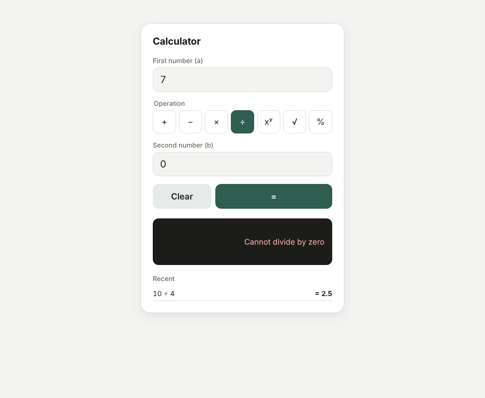

# Full-Stack Calculator

A calculator with a **React + TypeScript** frontend and a **Go** REST microservice. The frontend never computes results itself: it validates input, calls the API and renders the response.

- **Operations:** add, subtract, multiply, divide, power, square root, percentage
- **Backend:** Go 1.24, standard library only (no third-party dependencies)
- **Frontend:** React 19, TypeScript (strict), Vite, Vitest + React Testing Library
- **Tests:** 100% statement coverage on both layers — see [`docs/COVERAGE.md`](docs/COVERAGE.md)
- **Docker:** `docker compose up --build` runs the full stack on http://localhost:3000



---

## Project structure

```
.
├── backend/
│   ├── cmd/server/main.go          # wiring: config, HTTP server, graceful shutdown
│   ├── internal/calculator/        # pure domain logic (no HTTP), 100% unit tested
│   ├── internal/api/               # REST handlers, JSON decoding, error mapping, middleware
│   └── Dockerfile                  # multi-stage → distroless, non-root
├── frontend/
│   ├── src/domain/                 # operation metadata, input parsing/formatting
│   ├── src/api/                    # typed REST client + ApiError
│   ├── src/hooks/useCalculator.ts  # state + submit flow
│   ├── src/components/             # presentational Calculator component
│   ├── nginx.conf                  # serves SPA, proxies /api → backend
│   └── Dockerfile
├── docs/COVERAGE.md                # unit test & coverage report
├── docs/PROMPTS.md                 # AI prompts used
├── docker-compose.yml
└── Makefile
```

## Setup

**Prerequisites:** Go ≥ 1.24 , Node ≥ 20 (developed on 22). Docker is optional.

```bash
git clone https://github.com/MarianoMuri/sezzle-calculator.git
cd sezzle-calculator
make install          # = cd frontend && npm ci
```

## Running locally

Open two terminals:

```bash
# Terminal 1 – API on http://localhost:8080
make backend          # = cd backend && go run ./cmd/server

# Terminal 2 – UI on http://localhost:5173
make frontend         # = cd frontend && npm run dev
```

The Vite dev server proxies `/api/*` to `http://localhost:8080`, so the browser talks to a single origin.

### Configuration

| Variable          | Where    | Default                  | Purpose |
|-------------------|----------|--------------------------|---------|
| `PORT`            | backend  | `8080`                   | Listen port |
| `ALLOWED_ORIGIN`  | backend  | `http://localhost:5173`  | CORS origin; set to `""` to disable CORS |
| `VITE_API_URL`    | frontend (build time) | `""` (same origin) | Point the UI at an API on another host |
| `API_PROXY_TARGET`| frontend (dev server) | `http://localhost:8080` | Where the dev proxy forwards `/api` |

## Running with Docker

```bash
docker compose up --build
# UI  → http://localhost:3000
# API → reachable through the UI origin, e.g. http://localhost:3000/api/v1/add
```

nginx serves the static build and reverse-proxies `/api` to the backend container, so no CORS is needed in this setup.

## Tests

```bash
make test        # backend (with -race) + frontend
make coverage    # same, with coverage reports
```

Results and what each suite covers: [`docs/COVERAGE.md`](docs/COVERAGE.md).

---

## API

Base path: `/api/v1`. All bodies are JSON.

| Method | Path                       | Body             | Description |
|--------|----------------------------|------------------|-------------|
| POST   | `/api/v1/add`              | `{"a": n, "b": n}` | a + b |
| POST   | `/api/v1/subtract`         | `{"a": n, "b": n}` | a − b |
| POST   | `/api/v1/multiply`         | `{"a": n, "b": n}` | a × b |
| POST   | `/api/v1/divide`           | `{"a": n, "b": n}` | a ÷ b |
| POST   | `/api/v1/power`            | `{"a": n, "b": n}` | a ^ b |
| POST   | `/api/v1/sqrt`             | `{"a": n}`         | √a |
| POST   | `/api/v1/percentage`       | `{"a": n, "b": n}` | a % of b (`a / 100 × b`) |
| GET    | `/api/v1/operations`       | –                | Supported operations and their arity |
| GET    | `/healthz`                 | –                | Liveness probe |

### Examples

```bash
curl -X POST http://localhost:8080/api/v1/add \
  -H 'Content-Type: application/json' -d '{"a": 2, "b": 3}'
# 200 {"operation":"add","a":2,"b":3,"result":5}

curl -X POST http://localhost:8080/api/v1/sqrt \
  -H 'Content-Type: application/json' -d '{"a": 2}'
# 200 {"operation":"sqrt","a":2,"result":1.4142135623730951}

curl -X POST http://localhost:8080/api/v1/percentage \
  -H 'Content-Type: application/json' -d '{"a": 15, "b": 200}'
# 200 {"operation":"percentage","a":15,"b":200,"result":30}

curl -X POST http://localhost:8080/api/v1/divide \
  -H 'Content-Type: application/json' -d '{"a": 1, "b": 0}'
# 422 {"error":{"code":"division_by_zero","message":"division by zero"}}

curl -X POST http://localhost:8080/api/v1/add \
  -H 'Content-Type: application/json' -d '{"a": "1", "b": 2}'
# 400 {"error":{"code":"invalid_json","message":"field \"a\" must be a number"}}

curl http://localhost:8080/api/v1/operations
# 200 {"operations":[{"name":"add","operands":2}, ... ,{"name":"sqrt","operands":1}, ...]}
```

### Errors

Every error has the same shape: `{"error": {"code": "<stable_code>", "message": "<human text>"}}`. Clients should branch on `code`, not on `message`.

| Status | Code                  | When |
|--------|-----------------------|------|
| 400    | `invalid_json`        | Empty/malformed body, non-numeric value, unknown field, body > 1 KiB, more than one JSON object |
| 400    | `missing_operand`     | `a` (or `b` for binary operations) not provided |
| 400    | `invalid_operand`     | Operand is not a finite number |
| 404    | `unknown_operation`   | Path is not a supported operation |
| 405    | `method_not_allowed`  | Wrong HTTP method (response includes an `Allow` header) |
| 422    | `division_by_zero`    | `b = 0` in divide, or `0 ^ negative` |
| 422    | `negative_sqrt`       | `√a` with `a < 0` |
| 422    | `undefined_result`    | No real result, e.g. `(-8) ^ 0.5` |
| 422    | `result_out_of_range` | Result overflows float64 (e.g. `10 ^ 999`) |

---

## Design decisions & assumptions

**Backend**

- **Domain separated from transport.** `internal/calculator` is pure Go with no HTTP/JSON knowledge; it returns sentinel errors (`ErrDivisionByZero`, …). `internal/api` maps those to HTTP statuses via `errors.Is`. This keeps the math trivially unit-testable and reusable from another transport.
- **Operation registry.** Each operation is an entry `{arity, fn}` in a map. Adding modulo, for example, is one map entry plus a test — no handler or routing changes.
- **One endpoint per operation (`POST /api/v1/{operation}`).** Matches the brief ("expose endpoints for the operations"), reads well in logs and docs, and still uses a single handler thanks to Go 1.22 path patterns. POST is used because the operation is computed from a body, and it avoids number formatting issues in query strings.
- **Pointer fields in the request** (`*float64`) distinguish "missing" from an explicit `0`, so `{"a": 0, "b": 0}` is valid while `{"a": 1}` on `add` is a 400.
- **Strict input.** `DisallowUnknownFields`, a 1 KiB body limit and single-object check reject sloppy or abusive payloads early.
- **400 vs 422.** 400 means the request is malformed; 422 means it is well-formed but mathematically invalid. This lets the UI show a domain message ("Cannot divide by zero") instead of a generic error.
- **Numbers are IEEE-754 float64.** Results that overflow to ±Inf or become NaN are rejected rather than returned, because JSON cannot represent them. `-0` is normalised to `0`. Arbitrary-precision decimals were considered out of scope for 2–4 hours.
- **Percentage = "a% of b"** (`15 % of 200 = 30`), the most common calculator meaning. Square root is unary; a `b` sent to `/sqrt` is ignored.
- **Standard library only:** `net/http` routing, `log/slog` structured logs, graceful shutdown, server timeouts. No framework needed at this size.

**Frontend**

- **Form-based UI rather than a keypad.** Two explicit inputs plus an operation selector maps 1:1 to the API contract, makes validation messages unambiguous ("First number: Not a valid number") and works well with mobile numeric keyboards (`inputMode="decimal"`). The second input disappears for unary operations.
- **Layers:** `domain/` (pure functions), `api/` (typed client, `ApiError` with the backend `code`), `hooks/useCalculator` (state + flow), `components/` (presentational). The component accepts an injectable `calculateFn`, so UI tests run without network mocks.
- **Validate twice.** The client validates for instant feedback (regex rejects things `Number()` would silently accept, like `0x10` or `Infinity`, and accepts `3,5` as a decimal comma); the server remains the source of truth.
- **Error UX:** field-level errors with `aria-invalid`/`aria-describedby`, backend errors in an `aria-live` region with `role="alert"`, friendly messages per error code, and a clear message when the backend is unreachable.
- **Display:** results are formatted to 12 significant digits so `0.1 + 0.2` shows `0.3`; the API still returns the full float.
- **Extras kept small:** last 5 calculations, "use as next input" for chaining, light/dark theme via `prefers-color-scheme`, responsive layout that reflows the operation grid on phones.
- **Vite over Create React App.** CRA is deprecated by the React team; Vite is the current recommended tooling and integrates directly with Vitest.

**Not included (deliberately)**

Expression parsing (`2 + 3 × 4` in a single input), persistence of history, authentication and rate limiting. Each would be a reasonable next step but adds scope beyond what the brief prioritises (correctness, clarity, maintainability).

## AI usage

AI assistance was used, as allowed by the instructions. The prompts are listed in [`docs/PROMPTS.md`](docs/PROMPTS.md).
